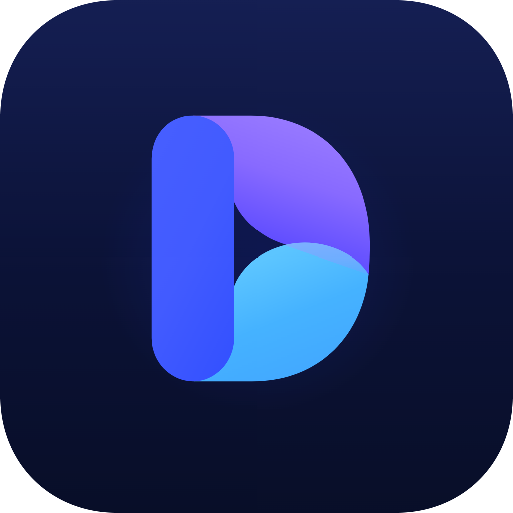
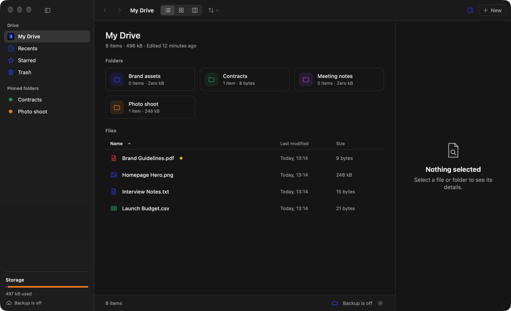

<p align="center">
  
</p>

<h1 align="center">Drive</h1>

<p align="center">
  A desktop app for macOS, Windows and Linux to keep your files and folders in one place, with a backup to your own AWS S3, Google Cloud Storage, Azure or Google Drive.
</p>



## What it is

Drive is a file manager for one folder on your computer. It looks and works like a cloud drive app.
Your files stay on your computer, so the app is fast and works offline.
If you add a bucket, Drive also copies your files there as a backup.

Drive is written in Rust with [Tauri 2](https://tauri.app). The window is plain HTML, CSS and JavaScript, with no framework.

## Features

- **Three views:** list, grid with picture previews, and columns.
- **Folders:** make folders, give them a color, and pin them to the sidebar.
- **Add files:** use the New button, or drag files and folders in from the file manager.
- **Organize:** rename, duplicate, move and star items.
- **Find:** press ⌘F (Mac) or Ctrl+F to search by name, sort by name, date or size, and see recent files.
- **Trash:** put items back, or delete them forever. Drive asks before it deletes.
- **Details pane:** preview, type, size, dates and backup state of the selected item.
- **Viewer:** open a picture, video, sound, text file or PDF in the app. Press Space or Enter on a selected file.
- **Tray icon:** start a backup, pause it, or open your files without the window.
- **Cloud backup:** AWS S3, Google Cloud Storage, Azure Blob Storage or Google Drive. New and changed files upload by themselves. You can restore them on another computer.

## Download

Get the file for your system from the [latest release](https://github.com/necessarylion/drive/releases/latest).

| System  | Chip                    | File                              |
| ------- | ----------------------- | --------------------------------- |
| macOS   | Apple silicon           | `Drive_x.y.z_aarch64.dmg`         |
| macOS   | Intel                   | `Drive_x.y.z_x64.dmg`             |
| Windows | 64-bit Intel or AMD     | `Drive_x.y.z_x64-setup.exe`       |
| Windows | ARM                     | `Drive_x.y.z_arm64-setup.exe`     |
| Windows | 32-bit                  | `Drive_x.y.z_x86-setup.exe`       |
| Linux   | 64-bit Intel or AMD     | `.deb`, `.rpm` or `.AppImage` with `amd64` or `x86_64` in the name |
| Linux   | ARM                     | `.deb`, `.rpm` or `.AppImage` with `arm64` or `aarch64` in the name |

Windows also has `.msi` files. Use them if you like them more than the `.exe` installer.

### macOS, with one line

Paste this line in the Terminal app:

```sh
curl -fsSL https://raw.githubusercontent.com/necessarylion/drive/main/install.sh | sh
```

It downloads the latest release and puts `Drive.app` in your Applications folder.
Run the same line again to update.

### If the system does not open the app

Drive is not signed with a paid certificate.

**macOS** says "Apple could not verify Drive is free of malware" when you downloaded it with a browser. To allow it:

1. Click **Done** in that message.
2. Open **System Settings > Privacy & Security**.
3. Scroll down and click **Open Anyway** next to Drive.

Or run this one time in Terminal:

```sh
xattr -dr com.apple.quarantine /Applications/Drive.app
```

**Windows** shows "Windows protected your PC". Click **More info**, then **Run anyway**.

### If you used the older Swift version on a Mac

- Your files, stars, pins and folder colors stay. The new app reads the same folder.
- Your access keys stay. They are still in the Keychain.
- Type the bucket, region and folder in **Settings** one more time. The new app keeps them in another place.
- Google Drive needs a new client of the type **Desktop app**. See below.

## Build from source

### Requirements

- [Rust](https://rustup.rs) 1.85 or newer
- [Bun](https://bun.sh). It is only used to install two dev tools: the Tauri CLI and Biome.
- The [system packages that Tauri needs](https://v2.tauri.app/start/prerequisites/).
  On Linux, also install `libdbus-1-dev` and `pkg-config`.

### Build and run

```sh
git clone https://github.com/necessarylion/drive.git
cd drive
make setup
make run
```

| Command       | What it does                                                    |
| ------------- | --------------------------------------------------------------- |
| `make setup`  | Install the dev tools                                           |
| `make run`    | Run the app. It builds again when the Rust code changes         |
| `make app`    | Build the app and its installers for this computer              |
| `make test`   | Run the tests                                                   |
| `make format` | Format the Rust code and the window code                        |
| `make lint`   | Check the format, and run Clippy and Biome                      |
| `make icon`   | Rebuild the app icons from `Resources/Logo.png`                 |

### Make a release

Push a tag that starts with `v`:

```sh
git tag v1.2.0
git push origin v1.2.0
```

GitHub Actions then builds the app for macOS, Windows and Linux, for every chip in the table above.
All builds run at the same time. The installers are added to the release of that tag.
You can also make the release and the tag on the GitHub website. The installers are added to it.

The tag must be three plain numbers, like `v1.2.0`.

The same workflow runs on every pull request. There it keeps the installers as workflow artifacts.

## Where your files are

By default, Drive keeps everything in one folder:

| System  | Folder                                  |
| ------- | --------------------------------------- |
| macOS   | `~/Library/Application Support/Drive`   |
| Linux   | `~/.local/share/Drive`                  |
| Windows | `%APPDATA%\Drive`                       |

| Path                | What is in it                                       |
| ------------------- | --------------------------------------------------- |
| `Files/`            | Your files and folders, as normal files on disk     |
| `Trash/`            | Items you moved to the trash                        |
| `metadata.json`     | Stars, pinned folders, folder colors, trash origins |
| `backup-state.json` | Which files are known to be in the backup           |

You can pick another folder in **Settings > Storage**.
The change takes effect after you quit and open Drive again.
Drive does not move files from the old folder to the new one.

The settings themselves are in `settings.json`, in the `Drive` folder of the settings place of your system
(on Linux this is `~/.config/Drive`; on macOS and Windows it is the same folder as above).

## Backup

The backup is optional. Drive works without it.
Open **Settings** (⌘, on a Mac, Ctrl+, on other systems, or the cloud icon in the status bar) and pick one provider:
AWS S3, Google Cloud Storage, Azure Blob Storage or Google Drive.

Drive keeps the keys in the keychain of your system: the Keychain on a Mac, the Credential Manager on Windows,
and the Secret Service (GNOME Keyring or KWallet) on Linux. It does not write them to a file.
Each provider has its own keys.

### Set up AWS S3

1. Create an S3 bucket in the AWS console.
2. Create an IAM user with an access key. Give it the policy below.
3. In Drive, open **Settings** and pick **AWS S3**.
4. Type the bucket name and its region.
5. Paste the access key ID and the secret access key, then click **Save Keys**.
6. Click **Test Connection**.

### Set up Google Cloud Storage

1. Create a bucket in the Google Cloud console.
2. Open **Cloud Storage > Settings > Interoperability** and create an HMAC key.
   The account of the key needs the **Storage Object Admin** role on the bucket.
3. In Drive, open **Settings** and pick **Google Cloud Storage**.
4. Type the bucket name.
5. Paste the access key and the secret of the HMAC key, then click **Save Keys**.
6. Click **Test Connection**.

### Set up Azure Blob Storage

1. Create a storage account and a container in the Azure portal.
2. Open the container, choose **Shared access tokens**, and make a SAS token.
   Allow Read, Add, Create, Write, Delete and List. Pick an end date far away.
3. In Drive, open **Settings** and pick **Azure Blob Storage**.
4. Type the storage account name and the container name.
5. Paste the SAS token, then click **Save Keys**.
6. Click **Test Connection**.

The SAS token stops working on its end date. Make a new one then and save it again.

### Set up Google Drive

Google only lets a registered app sign in. So you make a free client first. You do this one time.

1. Open the [Google Cloud console](https://console.cloud.google.com) and create a project.
2. Open **APIs & Services > Library**, find **Google Drive API**, and click **Enable**.
3. Open **Google Auth Platform** and click **Get started**. Type an app name and your email.
   Pick **External** as the audience. Do not add a logo.
   Google refuses an app name with "Drive" or "Google" in it. Use a name like `My Backup`.
4. Open **Data Access**, click **Add or remove scopes**, and add `.../auth/drive.file`.
5. Open **Audience** and click **Publish app**. Without this, you must sign in again every 7 days.
   If the button is off, open **Branding** first. Fill in a home page link and a privacy policy link,
   add the domain of these links under **Authorized domains**, and save.
6. Open **Clients** and click **Create client**. Pick **Desktop app** as the application type.
   Copy the client ID and the client secret.
7. In Drive, open **Settings** and pick **Google Drive**.
8. Paste the client ID and the client secret. Type a name for the backup folder, like `Drive Backup`.
9. Click **Sign In with Google…**. Your browser opens. Allow the access there, then go back to Drive.
10. Click **Test Connection**.

Drive can only see the files it uploaded itself. It cannot see your other Google Drive files.
Google does not review an app that only asks for this access.

Google says the client secret of a desktop app is not a real secret, so Drive keeps it with the settings.
The sign-in itself is kept in the keychain.

### IAM policy for AWS

Replace `my-drive-backup` with the name of your bucket.

```json
{
  "Version": "2012-10-17",
  "Statement": [
    {
      "Effect": "Allow",
      "Action": "s3:ListBucket",
      "Resource": "arn:aws:s3:::my-drive-backup"
    },
    {
      "Effect": "Allow",
      "Action": ["s3:PutObject", "s3:GetObject", "s3:DeleteObject"],
      "Resource": "arn:aws:s3:::my-drive-backup/*"
    }
  ]
}
```

### How it works

- Drive uploads a file when it is new, or when the copy on your computer is newer or has another size.
- The automatic backup only uploads. It never removes anything from the backup.
- **Back Up Now** (the cloud icon in the status bar) also looks for files that are in the backup but not on your computer.
  This happens after a rename or a delete. Drive asks you before it removes them from the backup.
- **Restore from Backup** downloads the files that are in the backup but not on your computer.
  It never replaces a file on your computer.
- The pause button in the status bar stops the automatic backup.

### Limits

- One file can be at most 5 GB.
- Bucket names with a dot or “_” in them are not supported.
- Stars, pins, folder colors, the trash and empty folders are not backed up.
- Drive is a backup tool, not a sync tool. It does not merge changes from two computers.
- On Google Drive, a removed file goes to the trash of Google Drive. Google deletes it after 30 days.
- Turn on versioning for your bucket if you want to undo a removed or replaced file.
- On Linux, the viewer cannot show a PDF. Open it in another app from there.

## Project layout

The code follows one direction: view → controller → service → repository → model.
Both sides are built this way, with dependency injection through the constructor.

```
src-tauri/                 The Rust side.
  src/lib.rs               The app entry point. All parts are wired together here (AppContainer).
  src/commands/            The functions the window can call. Each one only hands the call to a controller.
  src/controllers/         Build what the window shows, and keep the state of a running backup.
  src/services/            The rules of the drive, the backup, and AWS request signing.
  src/repositories/        All access to the disk, the keychain, S3, Azure and Google Drive.
  src/models/              Plain data types and the error type.
  src/config/              Where data is stored, and the backup settings.
  src/constants/           Global keys and limits.
  src/tray.rs              The tray icon and its menu.
  tests/                   Tests for the services and the backup code.
  tauri.conf.json          The window, the bundle and the security settings.
ui/                        The window. Plain files, no build step.
  index.html, css/app.css  The page and its look.
  js/main.js               All parts of the window are wired together here.
  js/views/                One class per part of the window.
  js/controllers/          The state of the window.
  js/repositories/         All calls to the Rust side.
  js/constants/, support/  Names, icons and small helpers.
Resources/Logo.png         The logo. The app icons are made from it.
.github/workflows/         The checks and the builds for all systems.
```

Requests to S3 are signed in `services/aws_signer.rs` with AWS Signature Version 4.
The tests check the signer against the examples in the AWS documentation.
Google Cloud Storage takes the same signed requests, so `S3Repository` is used for it too.
Azure has its own calls in `repositories/azure_repository.rs`.
Google Drive has its calls in `repositories/google_drive_repository.rs`, and its sign-in in `google_auth_repository.rs`.

## Development

To try the app without touching your real files, point it at another folder:

```sh
DRIVE_STORAGE_ROOT=/tmp/drive-demo make run
```

## Contributing

Issues and pull requests are welcome.

Before you open a pull request, please run:

```sh
make format
make lint
make test
```

## License

Drive is released under the MIT License. See [LICENSE](LICENSE).
